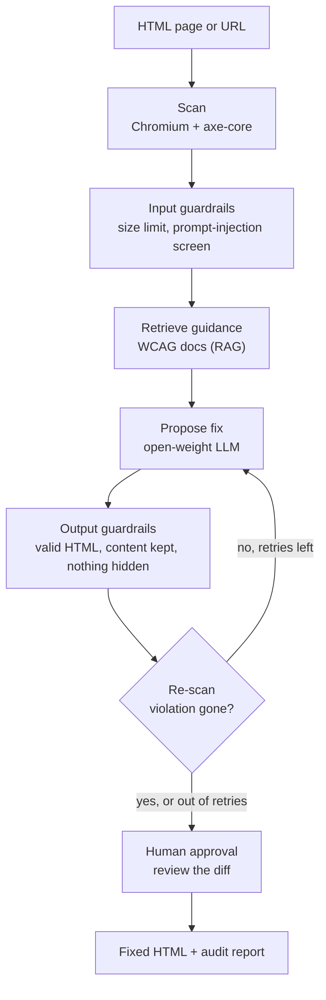

# Accessibility Repair Agent

An AI agent that finds web accessibility (WCAG) violations in HTML, fixes them,
and **proves each fix worked by re-scanning the page**. Built with LangGraph,
an MCP tool server, retrieval over the official WCAG documentation, and
guardrails. Runs on free, open-weight models.

> **Status:** Phase 0 (setup and resources) is complete and tested on Linux and
> Windows. Next: the evaluation harness and a zero-shot baseline.
> See the [build plan](docs/PLAN.md).

## The problem

A 2025 WebAIM study found that **94.8% of the top one million home pages fail
WCAG accessibility guidelines**, which shuts out people who rely on screen
readers, keyboards or magnification. Checkers such as axe-core *report* these
violations, but someone still has to fix every one by hand.

**Task.** Given a page's HTML, produce corrected HTML that removes its
machine-detectable WCAG violations without changing what the page says or how
it is structured, and verify every fix by scanning again.

**How success is measured.**

- *Main metric:* violation score decrease (from the AccessGuru paper, ASSETS
  2025) on the AccessGuru benchmark. We use the **178 of 250** syntax and
  layout violations that reproduce from their stored HTML with axe-core
  4.12.1, so every result is checked by a scanner, not judged by a model.
- *Comparison:* a zero-shot prompt and AccessGuru's prompting method, re-run
  with the same model and scorer, plus the paper's published numbers for context.
- *Second metric:* how often the guardrails reject a proposed fix, and why.
- *Constraint:* free open-weight models (OpenAI gpt-oss on Groq's free tier).

## How it works



The model only *proposes* changes. A deterministic scanner decides whether a
violation is gone, and a person approves the final diff.

## Quickstart

You need Python 3.11 or 3.12 and Git. Works on Windows 11, macOS 14+ and
recent Ubuntu; a basic laptop is enough because the model runs in the cloud.

```bash
git clone https://github.com/Harshit-rai-1506/accessibility-repair-agent.git
cd accessibility-repair-agent

python -m venv .venv
# Windows (PowerShell):  .venv\Scripts\Activate.ps1
# macOS / Linux:         source .venv/bin/activate

pip install -e ".[dev]"                     # project + all dependencies
python -m playwright install chromium       # headless browser (~150 MB)
python scripts/fetch_resources.py           # benchmark, axe-core, WCAG docs (~30 MB)

cp .env.example .env                        # Windows: copy .env.example .env
# paste a free Groq key (https://console.groq.com/keys) into .env
# .env stays on your laptop: never add it through the GitHub website

python scripts/check_setup.py               # every line should say OK
python -m pytest                            # 41 tests
python -m a11y_agent.loaders                # resources as LangChain Documents
python -m a11y_agent.scanner examples/broken_page.html
```

The step-by-step explanation of what each command does, and why, is in
[docs/00-setup.md](docs/00-setup.md).

## Roadmap

| Phase | What gets built | Agent concepts | Status |
|---|---|---|---|
| 0 | Environment, pinned resources, LangChain document loaders, scanner, scoring, model client, CI | Ground truth, reproducibility, Documents | ✅ Done |
| 1 | Benchmark loader, evaluation harness, zero-shot baseline | Evals before agents | Next |
| 2 | LangGraph agent: scan → fix → verify → retry, with state and checkpoints | Graphs, state, conditional edges, loops | Planned |
| 3 | MCP server exposing the scanner and fix tools; agent calls them as a client | Tool calling, MCP | Planned |
| 4 | Retrieval over WCAG Understanding docs and Techniques | Chunking, embeddings, hybrid search, metadata filters | Planned |
| 5 | Guardrails on input, output and actions, plus human approval | Prompt injection, validation, human-in-the-loop | Planned |
| 6 | Full benchmark run, ablations, cost and latency, write-up | Experiment design, reporting | Planned |

Details, acceptance criteria and budget for each phase: [docs/PLAN.md](docs/PLAN.md).

## Project layout

```
src/a11y_agent/
    config.py      settings from .env (model, axe version, paths)
    scanner.py     Chromium + axe-core: the ground truth for every fix
    scoring.py     violation score and fix verification (AccessGuru metric)
    llm.py         one function that returns the configured chat model
    loaders.py     LangChain document loaders (BaseLoader): benchmark rows, WCAG pages, axe rules
scripts/
    fetch_resources.py   downloads pinned, checksum-verified resources into data/
    check_setup.py       tells you exactly what is missing
examples/          a broken page (12 violated rules) and its hand-fixed version (0)
tests/             pytest suite, run on Linux and Windows by GitHub Actions
docs/              build plan and one explanatory guide per phase
```

## Credits

The benchmark, the scoring metric and the baseline prompting methods come from
**AccessGuru** (Fathallah, Hernández and Staab, ASSETS 2025). axe-core is by
Deque Systems; WCAG documents are by the W3C. Details and licences:
[THIRD_PARTY_NOTICES.md](THIRD_PARTY_NOTICES.md). Code in this repository is MIT
licensed.
