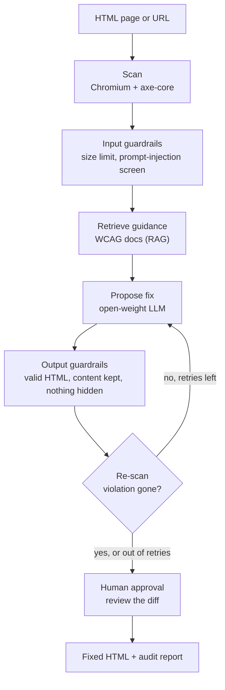

# Accessibility Repair Agent

An AI agent that finds web accessibility (WCAG) violations in HTML, fixes them,
and **proves each fix worked by re-scanning the page**. Built with LangGraph,
an MCP tool server, retrieval over the official WCAG documentation, and
guardrails. Runs on free, open-weight models.

> **Status:** Phases 0–5 are built and tested on Linux and Windows: setup,
> evaluation harness and baselines, the LangGraph agent, an MCP tool server
> the agent uses as a client, retrieval over the WCAG documents, and
> guardrails with human approval. Dev-set results below. Phase 6 (the final,
> frozen runs on the 138 held-back test items) is set up, behind one more dev
> check. See the [build plan](docs/PLAN.md).

## The problem

A 2025 WebAIM study found that **94.8% of the top one million home pages fail
WCAG accessibility guidelines**, which shuts out people who rely on screen
readers, keyboards or magnification. Checkers such as axe-core *report* these
violations, but someone still has to fix every one by hand.

**Task.** Given a page's HTML, produce corrected HTML that removes its
machine-detectable WCAG violations without changing what the page says or how
it is structured, and verify every fix by scanning again.

**How success is measured.**

- *Main metric:* violation score decrease (from the AccessGuru paper, ASSETS
  2025) on the AccessGuru benchmark. We use the **178 of 250** syntax and
  layout violations that reproduce from their stored HTML with axe-core
  4.12.1, so every result is checked by a scanner, not judged by a model.
  They are split once into a 40-item dev set and a 138-item test set
  ([splits/](splits/)); ACCESS (Huang et al. 2024) adds 100 more test items.
- *Comparison:* a zero-shot prompt and AccessGuru's prompting method, re-run
  with the same model and scorer, plus the paper's published numbers for context.
- *Side effects:* fixes that break another rule, and fixes that "work" by
  deleting content, are counted separately.
- *Second metric:* how often the guardrails reject a proposed fix, and why.
- *Constraint:* free open-weight models: OpenAI's gpt-oss-120b on Groq, and
  Mistral Small 4 on Mistral's API. Methods are compared on the same model.

## Results so far (dev set, 40 items, Mistral Small 4)

Every method run on the same model and the same 40 items:

| Method | Score decrease | Deletions count as failures (95% interval) | Resolved | Broke another rule | Deleted content | Tokens per item |
|---|---|---|---|---|---|---|
| Zero-shot prompt | 0.61 | 0.60 (0.45–0.74) | 23/40 | 7 | 2 | 1,825 |
| AccessGuru prompting (ASSETS 2025) | 0.75 | **0.47** (0.32–0.62) | 29/40 | 5 | **11** | 25,510 |
| Our agent (Phase 2) | 0.68 | 0.68 (0.53–0.83) | 28/40 | **0** | **0** | 7,721 |
| **Our agent with MCP tools** (Phase 3) | **0.78** | **0.78** (0.65–0.90) | **31/40** | 2 | **0** | 15,710 |
| Agent + tools + WCAG retrieval (Phase 4) | 0.64 | 0.64 (0.49–0.79) | 26/40 | 1 | **0** | 19,760 |
| Agent + tools + guardrails (Phase 5) | 0.64 | 0.64 (0.48–0.78) | 24/40 | 2 | **0** | 15,916 |

Score decrease is 1 − (violation score after ÷ before), from the AccessGuru
paper: 1.0 means every target fixed with nothing broken. The metric alone
rewards deleting the broken element, so the second column scores a fix that
removed content as no fix: AccessGuru's lead comes from deletions (11 of 40
items). The agent rows are after two rounds of error analysis
([docs/02-agent.md §14–15](docs/02-agent.md#14-error-analysis-round-1)).
Retrieval did not help: the passages were on topic, but the agent's failures
are mechanical, not a lack of WCAG knowledge, and the gap is within what
chance could do on 40 items
([docs/04-retrieval.md §11](docs/04-retrieval.md#11-what-retrieval-did-in-the-agent-dev-results)).
The guardrails cost nothing on element-level problems (0.72 either way); all
seven items they lost were page-level fixes that put `<main>` before `<html>`
or left `<</end>>` in the page, which axe-core accepts and the guardrails
reject. Counted fairly, with such fixes as no fix (the *safe score*, now in
every report), `agent_tools` also comes to about 0.64. The edit format now
makes those wraps valid HTML by construction; the dev re-run comes before
any test-set run
([docs/05-guardrails.md §10](docs/05-guardrails.md#10-dev-results-and-what-they-changed)).
With 40 items the 95% intervals are about ±0.14 wide, which is why the final
comparison uses the 138 held-back items, with paired tests.
Full tables, per-item outcomes
and the agent's step traces: [results/accessguru-dev](results/accessguru-dev/README.md).
The test set is held back until the end.

## How it works



The model only *proposes* changes. A deterministic scanner decides whether a
violation is gone, and a person approves the final diff.

Built so far: the scan → propose → verify → retry loop as a LangGraph state
machine ([docs/02-agent.md](docs/02-agent.md)). The model returns small JSON
edits rather than a rewritten page; every fix is re-scanned and checked for
deleted content, and failures are fed back for the next attempt. The scanner,
fix checker, rule explanations and a WCAG contrast calculator are served by an
MCP server; the agent uses it as a client, and the model can call tools while
it works ([docs/03-mcp-tools.md](docs/03-mcp-tools.md)). Before the first
attempt on a rule, hybrid search (BM25 + local embeddings) over the W3C's
WCAG documents puts the relevant techniques and failures in the prompt
([docs/04-retrieval.md](docs/04-retrieval.md)). Guardrails screen each page for
prompt injection, reject fixes that remove or hide content, add scripts or
break the markup (axe-core accepts `aria-hidden="true"` on an image as a fix
for missing alt text), and pause the graph so a person approves the final
diff ([docs/05-guardrails.md](docs/05-guardrails.md)).

## Quickstart

You need Python 3.11 or 3.12 and Git. Works on Windows 11, macOS 14+ and
recent Ubuntu; a basic laptop is enough because the model runs in the cloud.

```bash
git clone https://github.com/Harshit-rai-1506/accessibility-repair-agent.git
cd accessibility-repair-agent

python -m venv .venv
# Windows (PowerShell):  .venv\Scripts\Activate.ps1
# macOS / Linux:         source .venv/bin/activate

pip install -e ".[dev]"                     # project + all dependencies
python -m playwright install chromium       # headless browser (~150 MB)
python scripts/fetch_resources.py           # benchmark, axe-core, WCAG docs, embedding model (~65 MB)

cp .env.example .env                        # Windows: copy .env.example .env
# paste a free Groq key (https://console.groq.com/keys) into .env,
# or use Mistral: MODEL=mistralai:mistral-small-2603 and MISTRAL_API_KEY
# .env stays on your laptop: never add it through the GitHub website

python scripts/check_setup.py               # every line should say OK
python -m pytest                            # 252 tests (add -m "not slow" to skip the 1-2 minute one)
python -m a11y_agent.loaders                # resources as LangChain Documents
python -m a11y_agent.scanner examples/broken_page.html
```

Fix a page with the agent (Phase 2):

```bash
python -m a11y_agent.agent examples/broken_page.html         # writes examples/broken_page.fixed.html
python -m a11y_agent.agent page.html --thread my-page        # saves checkpoints; re-run to resume after a stop
python -m a11y_agent.agent --graph                           # the graph as a Mermaid diagram
```

Use the MCP tool server (Phase 3):

```bash
python scripts/try_mcp.py                                    # start the server, list and call its tools (no key needed)
python -m a11y_agent.mcp_server                              # stdio, for the MCP Inspector or Claude's desktop app
python -m a11y_agent.mcp_server --http --port 8765           # streamable HTTP at http://127.0.0.1:8765/mcp
python -m a11y_agent.agent examples/broken_page.html --tools # the agent as an MCP client, with model tools
```

Search the WCAG documents (Phase 4):

```bash
python -m a11y_agent.retrieval build                         # embed the corpus once (a few minutes on a laptop)
python -m a11y_agent.retrieval search "icon link has no accessible name" --sc 2.4.4
python -m a11y_agent.retrieval eval                          # hit@k and MRR: keywords vs embeddings vs hybrid
python -m a11y_agent.agent examples/broken_page.html --rag   # the agent with W3C guidance in its prompts
```

Guardrails and human approval (Phase 5):

```bash
python -m a11y_agent.guardrails screen examples/injection/attack-alt-text.html   # prompt-injection screen
python -m a11y_agent.guardrails check examples/broken_page.html examples/fixed_page.html
python -m a11y_agent.guardrails eval                          # attacks caught, false alarms on real pages
python -m a11y_agent.agent examples/broken_page.html --tools --approve    # you approve, edit or reject the result
```

Run the evaluation (Phases 1–5):

```bash
python -m a11y_agent.evaluate run --method noop              # harness check, no model, ~20 s
python -m a11y_agent.evaluate run --method zero_shot         # dev split, ~42K tokens
python -m a11y_agent.evaluate run --method accessguru        # dev split, ~350K tokens: spans 2 days of free quota
python -m a11y_agent.evaluate run --method agent             # dev split, roughly 60-120K tokens
python -m a11y_agent.evaluate run --method agent_tools       # dev split, roughly 100-180K tokens
python -m a11y_agent.evaluate run --method agent_rag         # dev split, agent_tools + retrieval
python -m a11y_agent.evaluate run --method agent_guarded     # dev split, agent_tools + guardrails
python -m a11y_agent.evaluate report                         # compare everything run so far
python -m a11y_agent.evaluate compare --save                 # 95% intervals, paired tests, cost and speed
python -m a11y_agent.evaluate failures --method agent_guarded --save   # why items were not fixed
```

The final runs (Phase 6) and a before/after on real public pages:
[docs/06-results.md](docs/06-results.md).

Runs resume where they stopped, and every model reply is cached, so
re-running never pays twice. You can also run evaluations on GitHub instead
of your laptop: see [docs/01-evaluation.md](docs/01-evaluation.md#9-running-it).

Step-by-step explanations: [docs/00-setup.md](docs/00-setup.md) (setup),
[docs/01-evaluation.md](docs/01-evaluation.md) (evaluation),
[docs/02-agent.md](docs/02-agent.md) (the LangGraph agent),
[docs/03-mcp-tools.md](docs/03-mcp-tools.md) (MCP tools),
[docs/04-retrieval.md](docs/04-retrieval.md) (retrieval) and
[docs/05-guardrails.md](docs/05-guardrails.md) (guardrails and human approval) and
[docs/06-results.md](docs/06-results.md) (final runs and how they are analysed).

## Roadmap

| Phase | What gets built | Agent concepts | Status |
|---|---|---|---|
| 0 | Environment, pinned resources, LangChain document loaders, scanner, scoring, model client, CI | Ground truth, reproducibility, Documents | ✅ Done |
| 1 | Fixed dev/test split, evaluation harness, zero-shot and AccessGuru baselines | Evals before agents, caching, rate limits | ✅ Done (dev numbers in) |
| 2 | LangGraph agent: scan → fix → verify → retry, with state and checkpoints | Graphs, state, reducers, conditional edges, structured output, checkpoints | ✅ Done (0.68 vs zero-shot 0.60) |
| 3 | MCP server exposing the scanner, fix checker, rule explanations and a contrast calculator; agent calls them as a client | MCP (tools, resources, prompts, stdio/HTTP), function calling | ✅ Done (0.78, best so far) |
| 4 | Retrieval over WCAG Understanding docs and Techniques, as a graph node and an MCP tool | Chunking, embeddings, hybrid search, metadata filters, retrieval evaluation | ✅ Done (did not help on dev; kept as method D) |
| 5 | Guardrails on input, output and actions, plus human approval | Prompt injection, validation, human-in-the-loop | ✅ Done (no cost on element-level fixes; 0/40 false alarms) |
| 6 | Full benchmark run, ablations, cost and latency, write-up | Experiment design, confidence intervals, error analysis, reporting | Set up; test runs next |

Details, acceptance criteria and budget for each phase: [docs/PLAN.md](docs/PLAN.md).

## Project layout

```
src/a11y_agent/
    config.py      settings from .env (model, axe version, paths)
    scanner.py     Chromium + axe-core: the ground truth for every fix
    scoring.py     violation score and fix verification (AccessGuru metric)
    llm.py         one function that returns the configured chat model
    loaders.py     LangChain document loaders (BaseLoader): benchmark rows, WCAG pages, axe rules
    benchmark.py   reproducible rows and the fixed dev/test split
    prompts.py     zero-shot and AccessGuru prompts; pulling HTML out of replies
    methods.py     repair methods behind one interface (noop, zero_shot, accessguru, agent, ..., agent_guarded)
    model_client.py  cached, rate-limited model calls; JSON-schema output; clean stops at the daily quota
    evaluate.py    the harness: scan, fix, re-scan, score, report
    agent.py       the LangGraph agent: state, nodes, conditional edges, checkpoints, CLI
    edits.py       the model's JSON edits: schema, validation, all-or-nothing apply, excerpts of long pages
    content.py     did a fix keep the page's words and elements?
    verification.py  one judgement of a fix, shared by the agent and the MCP tool
    contrast.py    WCAG contrast ratio and the closest colours that pass
    mcp_server.py  the MCP server (FastMCP): scan, verify, explain, contrast, search, safety tools; a resource; a prompt
    mcp_client.py  starts the server and connects: a remote scanner and LangChain tools for the model
    retrieval.py   chunking, BM25 + dense hybrid search, criteria filters, retrieval evaluation
    embeddings.py  bge-small embeddings on the CPU (ONNX), cached; a test stand-in
    guardrails.py  prompt-injection screen (rules + Llama Prompt Guard 2), checks on every fix, review flags
    stats.py       bootstrap confidence intervals, paired differences, sign tests
scripts/
    fetch_resources.py   downloads pinned, checksum-verified resources into data/
    check_setup.py       tells you exactly what is missing
    try_mcp.py           a tiny MCP client: see the server's tools in action
    public_pages.py      before/after: the guarded agent on real public pages
splits/            the dev/test split (row ids), made once and committed
results/           evaluation summaries, committed after each run (runs/ holds the full, ignored, output)
examples/          a broken page (12 violated rules), its hand-fixed version (0), and injection/ test pages
tests/             pytest suite, run on Linux and Windows by GitHub Actions
docs/              build plan and one explanatory guide per phase
```

## Credits

The benchmark, the scoring metric and the baseline prompting methods come from
**AccessGuru** (Fathallah, Hernández and Staab, ASSETS 2025). axe-core is by
Deque Systems; WCAG documents are by the W3C. Details and licences:
[THIRD_PARTY_NOTICES.md](THIRD_PARTY_NOTICES.md). Code in this repository is MIT
licensed.
