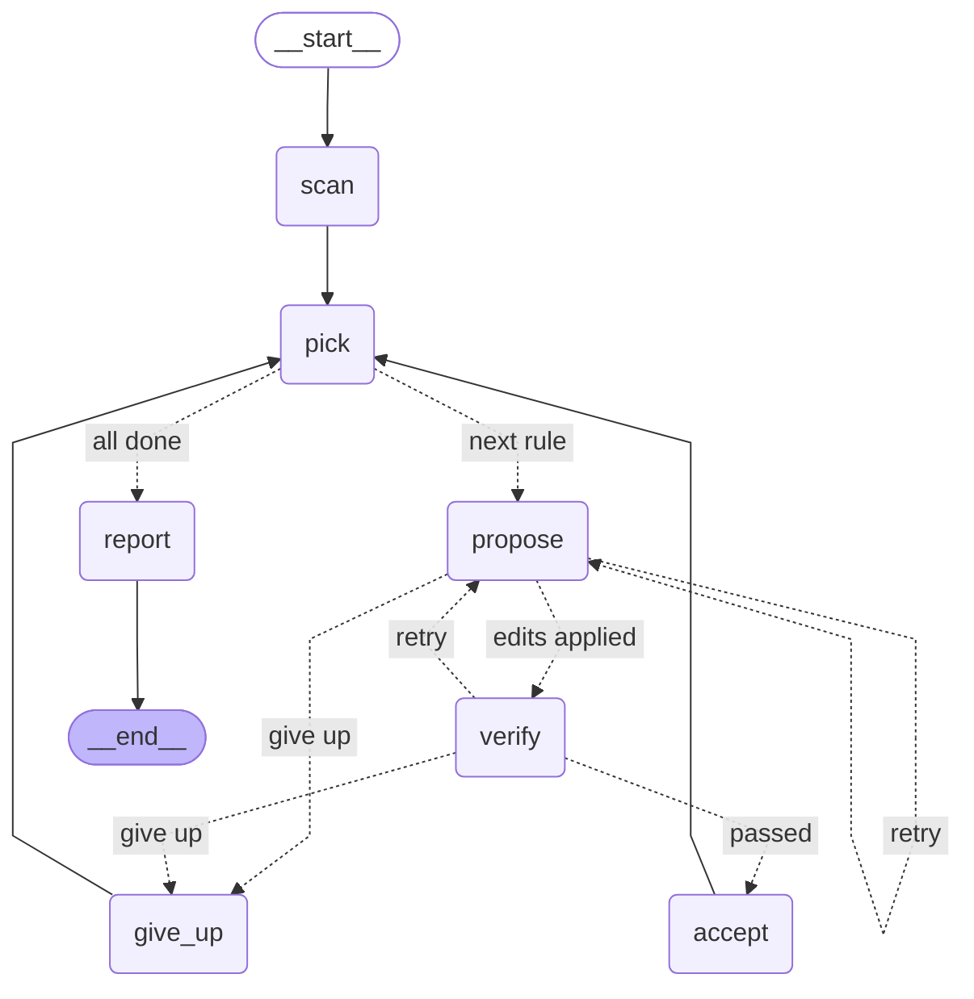

# Phase 2: The LangGraph agent — what we built and why

**Goal of this phase:** turn "ask the model once" into an agent that proposes
a fix, checks it with the scanner, and tries again with the scanner's
feedback until the fix passes or it runs out of attempts.

**The one idea to take away:** the model *proposes*; deterministic code
*decides*. The agent's intelligence is in the loop around the model: what it
is shown, how its answer is checked, and what it is told when it gets it
wrong. A graph is simply the clearest way to write that loop down.

---

## 1. Starting point: what the baselines got wrong

Your first runs on the 40 dev items (`results/accessguru-dev/`):

| Method | Score decrease | Resolved | Broke another rule | Dropped content | Too large to send | Tokens per item |
|---|---|---|---|---|---|---|
| zero_shot | 0.51 | 21/40 | 11 | 5 | 3 | 930 |
| accessguru (14 of 40 done before the daily quota) | 0.40 | 6/14 | 0 | 3 | 7 | 12,647 |

On the 7 items both methods could send, AccessGuru scores 0.87 against
zero-shot's 0.83, but at about 40 times the tokens, and its growing
four-turn conversation was too large for the free tier on half the items it
tried.

Each failure became a design decision:

| What went wrong | What the agent does about it |
|---|---|
| A fix broke another rule (11 of 40) | `verify` re-scans every fix; a fix that breaks anything is rejected, and the next attempt is told exactly which rule broke and on which element |
| A fix "worked" by deleting content (5 of 40) | `verify` also checks that 90% of the words and elements survive; deletions are rejected and explained |
| Too large to send (3 of 40, 7 of 14) | The model returns small **edits**, not the whole page, so the reply no longer grows with the page; long pages are shown as **excerpts** |
| AccessGuru spends ~13K tokens per item | One focused request per attempt, with a short summary of earlier failures instead of the whole conversation; stop as soon as a fix passes |

---

## 2. Chains, workflows and agents

- A **chain** runs fixed steps once: prompt → model → parse. Zero-shot is a chain.
- A **workflow** follows a path *you* designed, possibly with branches and loops.
- An **agent** lets the model choose its next step (which tool to call, when to stop).

This agent is deliberately a workflow with a loop. The model decides *how* to
fix a violation; the code decides *what happens next*, based on the scanner.
That keeps every run checkable and the cost bounded, which matters on a free
tier. Phase 3 hands the model a few tools it may call on its own, which is
where agent-style choices come in.

**Why LangGraph?** A loop with retries could be a `while` loop. LangGraph adds
what a plain loop does not give you: state saved after every step (resume
after a crash or a quota stop), a pause point for human approval (Phase 5),
step-by-step streaming and tracing, and a diagram of the control flow that is
generated from the code, so it is never out of date.

---

## 3. The graph

```bash
python -m a11y_agent.agent --graph        # prints this diagram
```



Solid arrows always happen; dotted arrows are **conditional edges**, chosen
by a small routing function after the node runs. The loop is
`propose → verify → propose`. A test checks this diagram matches the code.

In words, for a whole page:

1. **scan** the page once; queue every violated rule, most severe first.
2. **pick** the next rule (skipping rules an earlier fix already solved).
3. **propose**: ask the model for edits, apply them to a copy of the page.
4. **verify**: scan the copy. Passed → **accept** it and go back to *pick*.
   Failed with attempts left → *propose* again, with the reason. Failed and
   out of attempts → **give up** on this rule and go back to *pick*.
5. When the queue is empty, **report** the score before and after.

In the benchmark, the same graph runs with one target rule per item.

---

## 4. State: what the agent knows

`AgentState` in `src/a11y_agent/agent.py` is a `TypedDict`. Every node
receives the whole state and returns **only the fields it changes**.

| Field | What it holds |
|---|---|
| `html`, `targets` | the input page, and the rules to fix (empty = all) |
| `current_html` | the page with every accepted fix applied; each rule starts from it |
| `scan` | a compact scan of `current_html`: rule, impact, help text, up to 5 failing elements with axe's explanation |
| `queue`, `rule`, `attempt` | rules still to do, the rule being fixed, attempts so far |
| `candidate`, `verdict` | the latest proposed fix and verify's decision on it |
| `feedback` | what went wrong in earlier attempts **on this rule** |
| `candidates` | verified fixes for this rule, so *give up* can keep the best one |
| `outcomes`, `usage`, `steps` | results per rule, tokens per model call, and the trace |

Two design rules are worth copying into any agent:

**State must be serializable.** LangGraph saves the state after every step
(section 9), so it holds plain values: strings, numbers, lists, dicts. A scan
is stored as a small dict, not as a Python object. The browser and the model
client are *not* in the state at all (section 8).

**Reducers say how updates combine.** By default a node's update overwrites
the field. A field declared with a reducer is *combined* instead:

```python
outcomes: Annotated[list[dict], operator.add]     # append: grows for the whole run
feedback: Annotated[list[dict], per_rule_log]     # append, but None clears it
```

`per_rule_log` is a three-line custom reducer. `pick` sends
`feedback=None` when it starts a new rule, so the model is never shown
failures that belonged to a different rule. Without reducers, every node that
adds feedback would need to read the old list and copy it, and two nodes
updating the same list would overwrite each other.

---

## 5. Nodes and the bounded loop

Each node is an ordinary `async` function. A few details matter:

- **verify** passes a fix only if all three hold: the target rule is gone, no
  other rule newly fails, and at least 90% of the words and elements remain.
  It uses the same scoring function as the evaluation, so the agent and the
  harness agree on what "fixed" means.
- **The feedback is specific.** Not "try again" but, for example:
  `Your change made another rule fail, "link-name": <a href="/more"></a>
  (Fix any of the following: Element does not have text that is visible to
  screen readers ...)`. This text comes straight from axe-core. For contrast
  problems axe even states the measured ratio, the colours and the target
  (`contrast of 5.95 ... Expected contrast ratio of 7:1`), which gives the
  model numbers to work from.
- **give up** keeps a failed rule's best attempt only if it lowered the score
  without removing content (the target is gone but a milder rule now fails).
  On a whole page, that milder rule is queued so the agent tries to fix it too.

**Every loop needs two exits.** The planned one is `max_attempts` (3 per
rule): `verify` says "give up" when the attempts are used. The safety net is
LangGraph's `recursion_limit`, which stops any run after a fixed number of
steps even if a routing bug would loop forever. We set it from the worst case
(`recursion_limit()` in `agent.py`), and a test checks the arithmetic.

---

## 6. Structured output: edits, not pages

The model replies with JSON in this shape (from the Pydantic model
`FixProposal` in `src/a11y_agent/edits.py`):

```json
{
  "explanation": "The image had no text alternative; added alt text describing it.",
  "edits": [
    {"find": "", "replace": ""}
  ]
}
```

**How the format is enforced, in three layers:**

1. *The prompt* describes the format (needed for providers without schema support).
2. *The provider* constrains the output: the JSON schema generated from
   `FixProposal` is sent as `response_format` in strict mode, which Groq
   supports for the gpt-oss models. Strict mode needs every field to be
   required and no extra fields allowed; our models satisfy both (no field
   has a default, and `extra="forbid"` closes each object). If a provider
   rejects the option, the client notices once and falls back to prompt-only
   JSON.
3. *Our code* validates the reply again with Pydantic, because a valid schema
   does not guarantee a usable answer (a reply cut off by the token limit, an
   empty list of edits).

**Why edits?** Asking for the whole corrected page (as the baselines do) means
the reply is as long as the page, the model can quietly drop or rewrite parts
it never meant to touch, and long pages blow the request limit. With edits,
our code copies everything outside the edits byte for byte. Coding agents use
the same idea.

**Applying edits safely** (`apply_edits`):

- Each `find` must match exactly one place. Whitespace differences are
  tolerated, because models re-indent copied text.
- A `find` that matches nowhere, or in several places, becomes feedback:
  `Edit 1: the find text occurs 2 times (...). Include more of the
  surrounding HTML so it matches only one place.`
- **All or nothing.** If any edit fails, none are applied. Half a fix (an
  opening tag added, the closing one not) can be worse than no fix.

An unusable reply is handled exactly like a failed fix: it costs one attempt
and the next attempt is told why.

---

## 7. Fitting the free tier: budgets and excerpts

The free tier allows about 8,000 tokens per request, counting the prompt
*and* the reply budget. `build_request` plans every request at 90% of that,
because our token counts are estimates (about 4 characters per token):

- The reply budget is 1,024 to 3,072 tokens: room for gpt-oss's short
  reasoning plus the edits.
- If the page does not fit next to the prompt and the minimum reply budget,
  the model is shown an **excerpt**: the start and end of the document (its
  structure), and a window around each failing element, with
  `<!-- … 4210 characters not shown … -->` where text was left out. The
  prompt says every `find` must come from the parts shown. Edits are still
  applied to the full page.

Finding the failing elements in the source is not trivial: axe reports each
element as the browser re-wrote it (quotes normalised, at most 300
characters), which may not match the source text. `locate()` tries the whole
element, then its opening tag, then its most distinctive attribute value.

On the benchmark, the largest snippet (about 10,800 tokens, which neither
baseline could send) becomes a request of about 4,700 tokens.

---

## 8. Runtime context: dependencies are not state

The nodes need a browser (the scanner) and a model client. These are passed
per run, separately from the state:

```python
@dataclass
class AgentContext:
    scanner: Scanner
    model: ModelClient
    max_attempts: int = 3

await graph.ainvoke({"html": html}, config, context=AgentContext(scanner=scanner, model=model))

async def verify(state: AgentState, runtime: Runtime[AgentContext]) -> dict:
    after = await runtime.context.scanner.scan_html(state["candidate"]["html"])
```

A browser cannot be saved in a checkpoint, and should not be: when a run
resumes tomorrow it needs tomorrow's browser. Keeping live objects in the
runtime context also makes testing easy. The tests pass a fake model the same
way.

---

## 9. Checkpoints: stop, then carry on

Give the compiled graph a **checkpointer** and LangGraph saves the state after
every step, under a `thread_id`:

```bash
python -m a11y_agent.agent page.html --thread my-page
```

uses `AsyncSqliteSaver` (file `runs/checkpoints.sqlite`). If the run stops
part-way (daily quota, a crash, Ctrl+C), running the same command again finds
an unfinished thread (`snapshot.next` is not empty) and resumes it with
`graph.ainvoke(None, config)`: rules already fixed are not redone and their
model calls are not repeated. A test does exactly this: stop at the quota on
the second rule, resume in a "new process", and check that only the remaining
rules cost a model call.

Without `--thread`, the CLI uses `InMemorySaver`, which keeps checkpoints
only while the program runs. `--history` lists them, one per step:
LangGraph's "time travel" view, useful for seeing exactly what the agent knew
before each decision.

The evaluation harness runs the graph *without* a checkpointer: it already
saves results per item and caches every reply. Checkpoints come back in
Phase 5, where the graph pauses for a person to approve a fix, possibly hours
later, in another process.

---

## 10. Seeing what happened: the trace

- **Steps.** Every node adds one line to `steps`. The CLI streams them as the
  run happens (`graph.astream(..., stream_mode="updates")`), and the
  evaluation stores them per item in `runs/.../results.jsonl` (the `response`
  field), so every failure can be read afterwards:

  ```
  scan     scanned the page: 3 rule(s) violated, score 14; to fix: button-name, image-alt, html-has-lang
  pick     [image-alt] next rule: image-alt
  propose  [image-alt #1] 1 edit(s): "" -> "<a href="/more"></a>"
  verify   [image-alt #1] Your change made another rule fail, "link-name": ... -> retry
  propose  [image-alt #2] 1 edit(s): "" -> ""
  verify   [image-alt #2] passed -> accept
  ```

- **Usage.** Every model call records input and output tokens and seconds,
  so the report's cost columns work for the agent exactly as for the baselines.
- **LangSmith (optional).** Set `LANGSMITH_TRACING=true` and a free
  `LANGSMITH_API_KEY` in `.env`, and every run appears as a timeline of nodes
  and model calls, labelled by item (`run_name`, `tags`, `metadata` in
  `run_config()`).

---

## 11. The agent as evaluation method C

`methods.py` wraps the graph as one more method, `agent`, behind the same
interface as the baselines. The harness does not know it is a graph: it hands
over an item, gets HTML back, scans it and scores it like any other method.

Is it fair that the agent uses the scanner while fixing? Yes, and it is the
point: axe-core is available to anyone who deploys this, and AccessGuru's
published method also re-scans to decide whether to re-prompt. The risks of
optimising against your own checker are real (deleting content makes axe
happy), which is why `verify` checks content too, the report counts dropped
content, and Phase 5 adds stricter guardrails.

---

## 12. Testing an agent without a model

`tests/test_agent.py` runs the real graph and the real scanner with
`EditModel`, a fake chat model whose replies are scripted. Each test sets up
one situation and checks what the agent did:

- fixes every rule on a page, most severe first; fixes only the requested rule;
- a fix that breaks another rule is retried, and the retry prompt names the broken rule;
- invalid JSON and edits that match nothing become feedback;
- gives up after `max_attempts` and leaves the page unchanged;
- never accepts a deletion; keeps a partial improvement only when out of attempts;
- a daily-quota error stops the whole run; a request too large is reported, not retried;
- long pages are excerpted to fit; a provider without schema support still works;
- a stopped run resumes from its checkpoint without redoing finished rules;
- the diagram in this guide matches the code; the agent works inside the evaluation harness.

`tests/test_edits.py` covers reading and applying edits and the excerpts
without a browser. Scripted fakes make the tests fast, free, and exact about
*which* situation they test, which a real model cannot be.

---

## 13. Running it

Get the latest code and the new dependency (the SQLite checkpointer), then
check that the model returns usable edits:

```bash
git pull
pip install -e ".[dev]"
python scripts/check_setup.py        # new last line: "Agent reply  OK  usable JSON edits ..."
```

Fix a page:

```bash
python -m a11y_agent.agent examples/broken_page.html          # writes examples/broken_page.fixed.html
python -m a11y_agent.scanner examples/broken_page.fixed.html  # check it yourself
```

Measure it (method C) and compare with the baselines:

```bash
python -m a11y_agent.evaluate run --method agent
python -m a11y_agent.evaluate report --save
```

Expect roughly 60,000–120,000 tokens for the 40 dev items (about 1.5 attempts
per item), which fits in one day of free quota. The AccessGuru baseline
stopped at 14 of 40; run `--method accessguru` again on another day and it
continues from item 15.

How to read the agent's rows: `passes` is the number of attempts, and `note`
says how the rule ended (`fixed`, `improved`, `not_fixed`, `too_large`).

---

## 14. Error analysis, round 1

The first full dev runs (Mistral Small 4, October 2026) were mixed:

| Method | Score | Deletions count as failures | Target rule fixed | Broke another rule | Deleted content |
|---|---|---|---|---|---|
| zero_shot | 0.61 | 0.60 | 30/40 | 7 | 2 |
| accessguru | 0.75 | 0.47 | 34/40 | 5 | 11 |
| agent | 0.59 | 0.59 | 25/40 | 2 | 0 |
| agent_tools | 0.67 | 0.67 | 28/40 | 1 | 0 |

The agent was the safest method (no deletions, almost nothing broken) and
the best on colour contrast (7 of the 11 contrast items against zero-shot's 5), but it fixed the
target rule less often than zero-shot. `results/accessguru-dev/items__*.csv`
has one line per item with the agent's step trace. Reading the failures
showed five causes, none of them about the model's knowledge:

| Cause | Items | What the trace showed | Fix |
|---|---|---|---|
| Duplicate text | 165, 170, 069, 010 | Snippets repeat the same `` or CSS rule (carousel clones, repeated rules); every edit was rejected as "occurs 2 times" | `replace_all` on an edit changes every copy |
| Fragments, not pages | 121, 122, 131, 039 | The snippet is only `<html lang="en">`; the model edited a `</body>` or `</html>` that is not there | `<<start>>` / `<<end>>` insert at the beginning or end; the prompt says the HTML may be a fragment |
| New content trips `region` | 135, 141, 142, 187 | A new `<h1>` or label outside any landmark made "region" fail, three times in a row | Feedback now says how to pass the newly broken rule, in axe-core's words ("All page content is contained by landmarks"); the prompt says new content must not break other rules |
| Many failing elements | 175, 100 | Attempt 1 fixed 5 of 55 images; attempts 2 and 3 were cut off at 3,072 tokens, and the partial fix was thrown away | The reply budget grows with the number of failing elements (within the provider's limit), and **progress is kept**: a change that fixes some elements and breaks nothing becomes the starting point for the next attempt |
| Repeating itself | 039 | The same failed edit three times | Feedback points out a repeated change |

Two habits worth keeping from this:

- **Read the failures before changing anything.** Every fix above came from
  a trace, not a guess. A retrieval system (Phase 4) would not have fixed any
  of them, and adding it first would have hidden the real problems.
- **Fix mechanisms, not items.** Each change is general (any duplicated
  text, any fragment, any rule's pass conditions), and the test set has not
  been looked at. Tuning on dev is what dev is for; the test set stays
  untouched until the end.

**Deletions count as failures.** The metric alone rewards deleting the broken
element. Scored with deletions as failures, AccessGuru drops from 0.75 to
0.47, below every other method. The report now shows both numbers.

---

## What you can now explain

- **Workflow versus agent**, and why a verified loop is the right amount of autonomy here.
- **Typed state and reducers**: why state is plain data, and how `operator.add`
  and a custom reducer combine updates.
- **Conditional edges and bounded loops**: routing functions, `max_attempts`,
  and `recursion_limit` as a safety net.
- **Structured output in three layers**: prompt, provider-enforced JSON schema,
  Pydantic validation, and a fallback when the provider lacks schemas.
- **Edits instead of rewrites**: fewer tokens, no silent damage, all-or-nothing application.
- **Context budgets**: planning each request to fit a token limit, and excerpting long inputs.
- **Runtime context versus state**: what is saved, and what is passed in.
- **Checkpointing**: threads, resuming a stopped run, state history.
- **Observability**: streamed steps, per-call token accounting, LangSmith traces.
- **Testing agents with scripted fake models**.
- **Error analysis**: reading traces to find mechanical causes, fixing them
  generally, and keeping the test set out of it.

## Next: Phase 3

Move the scanner and a few helpers behind an **MCP server** (`scan_html`,
`verify_fix`, `explain_rule`, plus a contrast calculator, because working out
a colour with a 7:1 contrast ratio is arithmetic a tool should do, not a
language model). The agent then calls them as tools, deciding for itself when
to look up a rule or compute a colour, and the same tools become usable from
any MCP client. (Built: [docs/03-mcp-tools.md](03-mcp-tools.md).)
